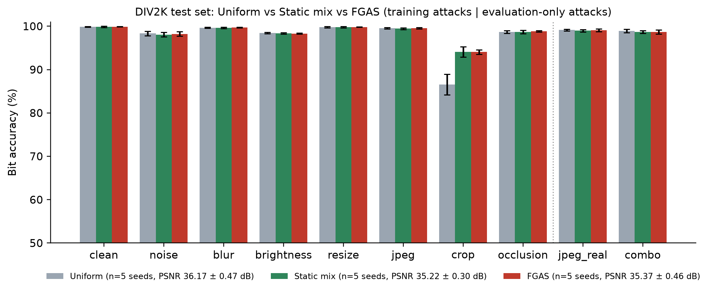
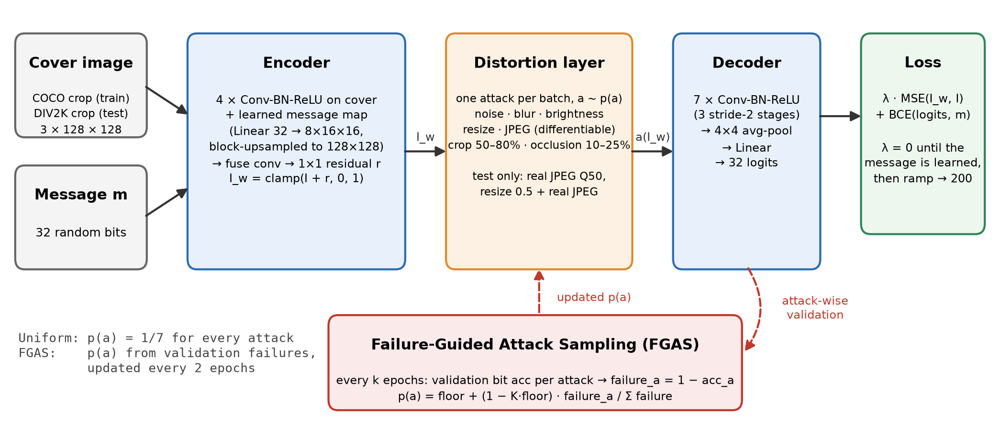
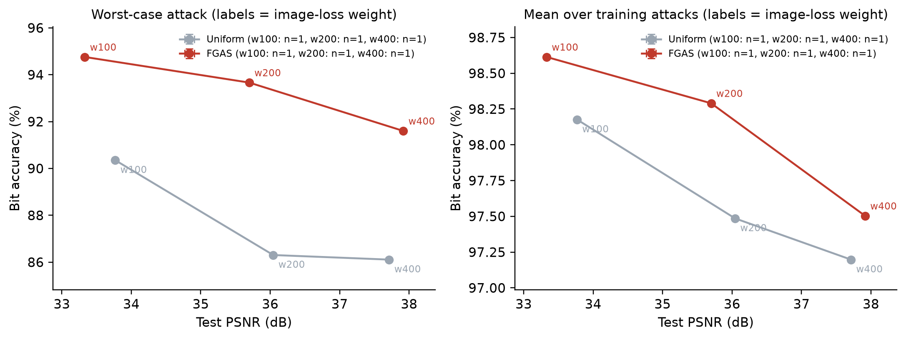
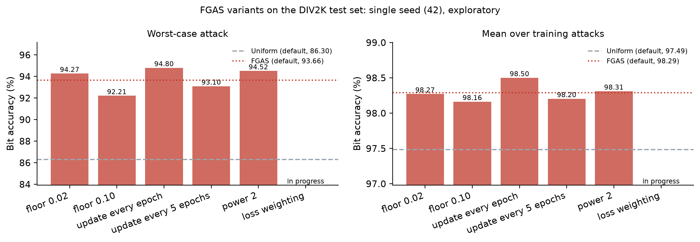
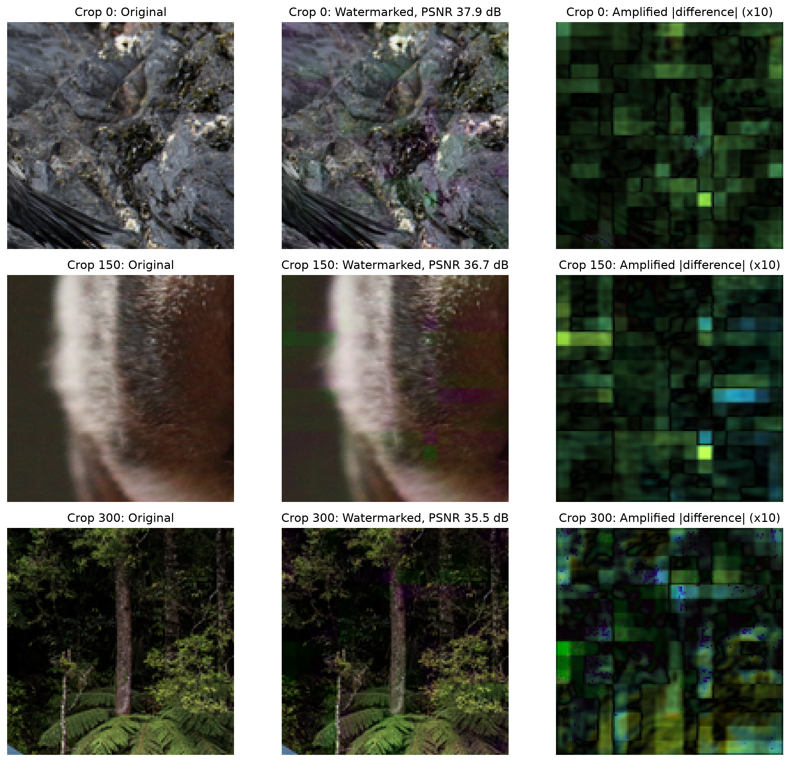

# Failure-Guided Attack Sampling for Robust Neural Image Watermarking

**CMPE 258 · Team 7:** Niveditha Nandakumar Kamath, Sabari Iyyappan Duraipandian, Taehun Lee

[](https://colab.research.google.com/github/TaehunLeee5/CMPE258_Team7/blob/main/notebooks/demo_colab.ipynb)

A neural network hides a 32-bit message inside a photo so that it is barely visible, and a second network reads it back, even after the photo is cropped, compressed, blurred, resized or partly covered. We train the pair against these attacks and ask one question:

> **Does practising more on the attacks the model currently fails at make the watermark more robust where it is weakest?**

Our method, **Failure-Guided Attack Sampling (FGAS)**, regularly quizzes the model on each attack and shifts training towards the ones it gets wrong, like a student who spends more time on the chapters they keep failing.

## Highlights

Five seeds per method, all trained on a Colab Tesla T4, scored on 400 crops from **DIV2K images never used for training or model selection**:

| | Uniform sampling | **FGAS (ours)** |
|---|---|---|
| **Hardest attack (crop), bit accuracy** | 86.5% | **94.1%** (+7.5 pp, better on **5 of 5** seeds) |
| Cropped images with the **whole message** correct | 15.0% | **47.6%** (about 3×) |
| Average over the 7 training attacks | 97.3% | **98.4%** |
| Whole message correct, averaged over attacks | 73.9% | **78.3%** |
| Image quality (PSNR) | **36.2 dB** | 35.4 dB |

- FGAS is ahead on the hardest attack, the average and full-message accuracy **on every seed**, at a cost of 0.8 dB of image quality.
- The gain holds **beyond the training strength** (crop keeping only 50% of the image: 81.3% vs 71.5%), at **every image-quality level** we tried, and for **every FGAS setting** we varied.
- A control run shows **where** the gain comes from: FGAS discovers that crop needs about 35% of training, instead of 14%.



## How it works



- **Encoder** ([models.py](src/wm/models.py)): turns the 32 bits into a learned 16×16 message map, combines it with features of the photo, and adds a small residual: `watermarked = clamp(photo + residual, 0, 1)`.
- **Distortion layer** ([attacks.py](src/wm/attacks.py)): one attack per training batch, all differentiable: Gaussian noise σ 0.1, blur 9×9 σ 2, brightness ×0.3–1.7, resize ×0.25, JPEG quality 50–90, crop keeping 50–80% of the area, occlusion of 10–25%. Real JPEG Q50 and resize 0.5 + real JPEG are **only used at test time**.
- **Decoder**: a convolutional network that predicts the 32 bits.
- **Loss**: `λ · MSE(watermarked, photo) + BCE(predicted bits, message)`. λ (the image-loss weight) trades invisibility against robustness.

**Choosing the attack for each batch:**

| | How the attack is picked |
|---|---|
| **Uniform** (baseline) | each of the 7 attacks with probability 1/7, all run |
| **FGAS** (ours, [fgas.py](src/wm/fgas.py)) | every 2 epochs, measure bit accuracy per attack on held-out validation images, then set each attack's probability in proportion to its failure rate (1 − accuracy) |
| **Static mix** (control) | FGAS's final mix (crop 0.345, noise 0.157, brightness 0.128, occlusion 0.125, jpeg 0.090, blur 0.082, resize 0.073), fixed from the start |

FGAS's update, for K attacks with validation accuracy `acc_a`:

```
failure_a = 1 - acc_a
target_a  = floor + (1 - K * floor) * failure_a / Σ_b failure_b     (floor = 0.05: no attack ever disappears)
p_a       = 0.5 * p_a(previous) + 0.5 * target_a                     (momentum: no sudden swings)
```

FGAS can be read as a cheap approximation of **distributionally robust optimisation**: it aims to minimise the loss under the worst mix of attacks rather than the average one.

## Results

All numbers below: DIV2K test set, mean ± sample std over 5 seeds (42–46), image-loss weight 200, 60 epochs. Raw runs, tables and figures are in [results/final/warm0/](results/final/warm0/).

### Uniform vs static mix vs FGAS

| | Uniform | Static mix | FGAS |
|---|---|---|---|
| **Hardest attack (crop) bit accuracy** | 86.52 ± 2.38% | **94.07 ± 1.20%** | **94.05 ± 0.52%** |
| Crop, whole message correct | 14.95 ± 7.32% | 50.45 ± 5.65% | 47.55 ± 1.97% |
| Average over the 7 training attacks | 97.28 ± 0.38% | 98.29 ± 0.36% | 98.36 ± 0.06% |
| Whole message correct, average | 73.93 ± 2.96% | 77.69 ± 3.16% | 78.31 ± 1.61% |
| No attack (clean) | 99.89% | 99.86% | 99.89% |
| PSNR | 36.17 ± 0.47 dB | 35.22 ± 0.30 dB | 35.37 ± 0.46 dB |

**Every run, one dot per seed.** The FGAS and static-mix runs sit well above every uniform run on crop; all other attacks stay near 98–100%.


**Per-seed differences, FGAS − uniform:**

| Seed | 42 | 43 | 44 | 45 | 46 | Mean ± std |
|---|---|---|---|---|---|---|
| Hardest attack (pp) | +9.52 | +7.16 | +7.41 | +4.52 | +9.05 | **+7.53 ± 1.97** |
| Average over attacks (pp) | +1.24 | +1.27 | +0.99 | +0.54 | +1.37 | +1.08 ± 0.33 |
| Whole message (pp) | +3.07 | +8.61 | +3.32 | +0.14 | +6.79 | +4.39 ± 3.33 |
| PSNR (dB) | −0.51 | −1.40 | +0.37 | −1.41 | −1.08 | −0.80 ± 0.75 |

**Success test, set before the runs** ([main_comparison_criterion.json](results/final/warm0/main_comparison_criterion.json)):

| Check | Required | FGAS vs uniform | |
|---|---|---|---|
| Hardest attack | at least +2 pp | **+7.53 pp** | ✅ |
| Average over attacks | at most 0.5 pp lower | +1.08 pp | ✅ |
| Clean accuracy | at least 98% | 99.89% | ✅ |
| Image quality | within 0.5 dB | −0.80 dB | ❌ |

Robustness passed by a wide margin. The watermark is 0.8 dB more visible than uniform's, over the 0.5 dB limit we set in advance, so we count the test as not passed. For scale: in our trade-off runs, uniform sampling gains only about 1.8 pp on the hardest attack per dB of image quality it gives up, so 0.8 dB would buy it roughly 1.4 pp, against FGAS's 7.5 pp.

### Where does the gain come from?

The static mix trains on FGAS's final attack mix from the start, with no adapting. It matches FGAS on every metric (paired difference on the hardest attack: −0.01 ± 1.03 pp; [static_vs_fgas_criterion.json](results/final/warm0/static_vs_fgas_criterion.json)).

So the gain comes from **training much more on the hardest attack** (crop: about 35% of batches instead of 14%), and so does the image-quality cost. What FGAS contributes is **finding** that mix automatically, from validation failures, in a single run, without knowing in advance which attack is hardest or how much more practice it needs. The static mix was only available because FGAS had found it.


FGAS moves crop from 14% to about 35% within the first few updates, taking batches mostly from blur, resize and JPEG, which are already near 100%.

### Stronger attacks than seen in training


| Attack (test only) | Uniform | Static mix | FGAS |
|---|---|---|---|
| Crop, keep 50% | 71.5% | 81.9% | 81.3% |
| Crop, keep 35% | 57.1% | 63.4% | 62.7% |
| Occlusion 55% | 87.8% | 88.8% | 88.7% |
| Noise σ 0.2 | 87.0% | 84.2% | 85.5% |
| Real JPEG quality 10 | 73.1% | 72.9% | 71.0% |

The crop gain carries over to much harsher crops. The crop-heavy mixes give up 1.5–2.8 pp on very strong noise: the price of focusing on the worst attack instead of the average.

### At matched image quality

Single seed (42), image-loss weight 100 / 200 / 400 ([results/final/variants/](results/final/variants/)):



| Image weight | Method | PSNR | Hardest attack | Average |
|---|---|---|---|---|
| 100 | Uniform | 33.77 dB | 90.35% | 98.18% |
| 100 | FGAS | 33.33 dB | **94.76%** | 98.61% |
| 200 | Uniform | 36.04 dB | 86.30% | 97.49% |
| 200 | FGAS | 35.70 dB | **93.66%** | 98.29% |
| 400 | Uniform | 37.71 dB | 86.11% | 97.20% |
| 400 | FGAS | **37.92 dB** | **91.60%** | 97.50% |

The FGAS curve lies above the uniform one at every quality level. At weight 400 FGAS is **both** more robust (+5.5 pp) **and** less visible (+0.21 dB).

### FGAS settings (ablations)

Single seed (42); each variant changes one setting ([configs/](configs/), checked by `tests/test_configs.py`):



| Variant | PSNR | Hardest attack |
|---|---|---|
| Uniform (reference) | 36.04 dB | 86.30% |
| FGAS default (floor 0.05, update every 2 epochs) | 35.70 dB | 93.66% |
| floor 0.02 | 35.36 dB | 94.27% |
| floor 0.10 | 35.43 dB | 92.21% |
| update every epoch | 35.30 dB | 94.80% |
| update every 5 epochs | 35.87 dB | 93.10% |
| failure squared (power 2) | 35.26 dB | 94.52% |

Every variant beats uniform by 5.9–8.5 pp: the method does not depend on careful tuning. With one seed, the variants should not be ranked against each other.

### U-Net-SE encoder comparison

We evaluated a U-Net encoder with squeeze-and-excitation blocks using uniform
sampling and FGAS over seeds 42–44. Each model trained for 60 epochs on COCO
and was evaluated on the held-out DIV2K test set.

Both methods used a starting image-loss weight of 0.01, a latest ramp-start
epoch of 20, an eight-epoch ramp, and a final image-loss weight of 200.
These settings enabled learning in the DIV2K development run, but all six
COCO comparison runs remained near chance training accuracy.

| Test metric | Uniform | FGAS |
|---|---:|---:|
| Clean bit accuracy (%) | 49.86 ± 0.52 | 50.41 ± 0.57 |
| Worst-case bit accuracy (%) | 49.83 ± 0.52 | 50.35 ± 0.56 |
| Mean attacked bit accuracy (%) | 49.85 ± 0.52 | 50.40 ± 0.57 |
| Mean attacked full-message accuracy (%) | 0.00 ± 0.00 | 0.00 ± 0.00 |
| PSNR (dB) | 69.35 ± 2.97 | 64.98 ± 13.40 |

Values are mean ± sample standard deviation across three seeds.
The paired worst-case difference, FGAS minus uniform, was
+0.52 ± 0.79 percentage points. The comparison criterion was not met.
Training must become reliable before these experiments can establish
whether FGAS improves recovery with this encoder.

Results, per-run configurations, logs, and evaluation files are available
in [results/final/unet](results/final/unet/).
The [criterion JSON](results/final/unet/unet_comparison_criterion.json)
includes paired per-seed differences.

To reproduce one matched pair after preparing COCO and DIV2K data:

```bash
python scripts/train.py --config configs/hard_uniform_unet.yaml \
  --set experiment.name=hard_uniform_unet_s42 experiment.seed=42

python scripts/train.py --config configs/hard_fgas_unet.yaml \
  --set experiment.name=hard_fgas_unet_s42 experiment.seed=42
```

Repeat with seeds 43 and 44, updating both the experiment name and seed.
Each completed run evaluates its selected checkpoint on the held-out
DIV2K test set.

To regenerate the comparison table and criterion report from the saved runs:

```bash
python scripts/aggregate_seeds.py \
  results/final/unet/runs/hard_uniform_unet_s* \
  results/final/unet/runs/hard_fgas_unet_s* \
  --out results/final/unet/unet_comparison \
  --criterion hard_uniform_unet hard_fgas_unet
```

**Re-weighting sampling vs re-weighting the loss** (seed 42). Instead of drawing hard attacks more often, the loss of hard attacks can be multiplied up (as in Group DRO). Using the same FGAS signal both ways: hardest attack 84.00% (uniform) → 91.20% (loss weighting) → **93.52% (sampling, FGAS)**, all at about 35.4–35.9 dB ([sampling_vs_lossweight.md](results/final/warm0/sampling_vs_lossweight.md)). On this seed, changing *what the model sees* works better than changing *how much each mistake counts*.

### What the watermark looks like



FGAS model, seed 42, three DIV2K test crops: original, watermarked, and the difference amplified 10×. At normal viewing size the watermark is hard to see; zoomed in, faint colour blocks are visible in flat regions.

### Training reliability

An earlier 5-seed attempt used an image-loss weight of 1 (instead of 0) during the first epochs. **4 of its 10 runs never learned the message** and stayed at 50% (chance) on every attack, including clean images. The cause is a race in epoch 2, before FGAS does anything: if the encoder shrinks its changes before the decoder has picked anything up, the signal stays far below the noise attack and never recovers. It hit both methods.

Setting the image-loss weight to **0 until the message is learned** removed the problem: a check on exactly the seeds that had failed passed 6 of 6, and all 15 runs above learned the message. The earlier attempt's runs and tables are kept in [results/final/main/](results/final/main/) (FGAS was ahead by +7.4 and +4.9 pp on the two seeds where both methods learned); the diagnosis is in [#12](https://github.com/TaehunLeee5/CMPE258_Team7/issues/12).

### Limitations

- 128×128 crops and 32-bit messages; no higher resolutions or longer messages.
- The image-quality trade-off, ablations and loss-weighting comparison use a single seed.
- The watermark is not perceptually optimised (no GAN or LPIPS loss), so faint blocks can show when zoomed in.
- In this setting the adaptive schedule itself adds nothing over its final mix; whether adaptation helps when the hardest attack changes during training is untested.

## Demo

[notebooks/demo_colab.ipynb](notebooks/demo_colab.ipynb) launches a Gradio app in Colab with a public link: upload a photo, type a 4-character message, pick an attack and its strength, and see the original, watermarked and attacked images, the decoded text and the number of wrong bits. The demo logic is in [src/wm/demo.py](src/wm/demo.py) and is unit-tested.

## Reproduce

**Official numbers come from Google Colab with a T4 GPU** via [notebooks/checkin3_colab.ipynb](notebooks/checkin3_colab.ipynb): it downloads the data, runs any list of jobs, writes everything to Google Drive and resumes after a disconnect. Add these jobs, set `MY_JOBS`, run, then run the severity-sweep cell:

```python
for seed in (42, 43, 44, 45, 46):
    ALL_JOBS[f'hard_uniform_warm0_s{seed}'] = ('configs/hard_uniform_warm0.yaml', seed, [])
    ALL_JOBS[f'hard_fgas_warm0_s{seed}'] = ('configs/hard_fgas_warm0.yaml', seed, [])
    ALL_JOBS[f'hard_static_warm0_s{seed}'] = ('configs/hard_static_warm0.yaml', seed, [])
ALL_JOBS['hard_fgas_lossweight_warm0_s42'] = ('configs/hard_fgas_lossweight_warm0.yaml', 42, [])
```

The same steps from a terminal:

```bash
pip install -r requirements.txt                                     # install a CUDA build of torch first if needed
python -m pytest -q                                                 # unit tests, CPU only

# Data: COCO val2017 for training and validation (4500 / 500), DIV2K valid HR as the held-out test set
python scripts/download_coco.py --config configs/hard_base.yaml
python scripts/prepare_coco.py --config configs/hard_base.yaml
python scripts/download_div2k.py --splits valid
python scripts/prepare_div2k.py --splits val

# Train (60 epochs); best.pt is then scored on the DIV2K test set -> runs/<name>/best_test_eval.json
python scripts/train.py --config configs/hard_fgas_warm0.yaml --set experiment.name=hard_fgas_warm0_s42 experiment.seed=42
python scripts/sweep.py --checkpoint runs/hard_fgas_warm0_s42/best.pt --out runs/hard_fgas_warm0_s42/sweep.csv

# Tables, success test and figures
W=results/final/warm0; R=$W/runs
python scripts/aggregate_seeds.py $R/hard_uniform_warm0_s* $R/hard_static_warm0_s* $R/hard_fgas_warm0_s* \
    --out $W/main_comparison --criterion hard_uniform_warm0 hard_fgas_warm0
python scripts/aggregate_seeds.py $R/hard_static_warm0_s* $R/hard_fgas_warm0_s* --out $W/static_vs_fgas \
    --criterion hard_static_warm0 hard_fgas_warm0
python scripts/aggregate_seeds.py $R/hard_uniform_warm0_s* $R/hard_static_warm0_s* $R/hard_fgas_warm0_s* \
    --no-group --out $W/per_run
python scripts/sweep.py --plot $R/hard_{uniform,static,fgas}_warm0_s*/sweep.csv --out $W/figures/severity_sweep.png
python scripts/report_figures.py --hard-dir $W --out-dir $W/figures --only method_bars per_run_strip fgas_over_time
python scripts/report_figures.py --out-dir results/final/figures --only pipeline
python scripts/figure1.py --checkpoint $R/hard_fgas_warm0_s42/best.pt --split test --indices 0 150 300 \
    --out results/final/figures/figure1.png
```

The trade-off and ablation runs use `configs/hard_{uniform,fgas}.yaml` with `--set train.image_loss_weight=100|400` and `configs/hard_fgas_{floor002,floor010,int1,int5,p2}.yaml`; their tables are built with `aggregate_seeds.py --no-group` and `report_figures.py --only trade_off ablations`.

Any config value can be overridden with `--set key=value`. `--set data.synthetic=true train.epochs=2 data.test=null` runs a quick smoke test without downloading anything. Each run writes `config.yaml`, `run_info.json` (git commit, GPU, seed), `metrics.csv` (per-epoch accuracy per attack, PSNR, sampling probabilities), `best.pt`, `last.pt` (for resuming), `best_test_eval.json` and, for FGAS, `fgas_history.json`.

## Repository layout

```
configs/     hard_base.yaml (benchmark), hard_{uniform,fgas,static}_warm0.yaml (main result),
             hard_fgas_lossweight_warm0.yaml, hard_{uniform,fgas}.yaml + hard_fgas_*.yaml (trade-off, ablations),
             baseline.yaml and others (early DIV2K development setup)
src/wm/      data, messages, models (incl. optional U-Net + squeeze-and-excitation encoder), attacks,
             metrics, evaluate, fgas, trainer, demo
scripts/     download/prepare/validate data, train, evaluate, sweep, aggregate_seeds, report_figures, figure1
notebooks/   checkin3_colab.ipynb (training runs on Colab), demo_colab.ipynb (Gradio demo),
             checkin2_colab.ipynb (early DIV2K baseline)
tests/       pytest suite: shapes, gradients, attacks, metrics, FGAS, configs, training loop, figures, demo
results/     final/warm0 (main result), final/variants (trade-off, ablations), final/main (earlier 5-seed attempt),
             final/figures; results/ and results/checkin3/ hold earlier development runs
```

## Team contributions

| Member | Contributions |
|---|---|
| Sabari Iyyappan Duraipandian | Repo structure, data pipeline, encoder/decoder, distortion layer, attack-wise validation, FGAS and training integration; FGAS variants (loss-weighting mode, ablations), trade-off and ablation figures; warm-up diagnosis and fix, static-mix control, main results |
| Niveditha Nandakumar Kamath | Dataset and PSNR/SSIM validation, COCO pipeline and held-out test split, Figure 1, full-message and paired per-seed statistics, severity sweep, earlier 5-seed comparison, per-run strip plot, main-result runs for seeds 45–46 |
| Taehun Lee | Baseline experiment runs, robustness benchmark, tables and plots, U-Net + squeeze-and-excitation encoder option, Gradio demo |

## References

- J. Zhu, R. Kaplan, J. Johnson, L. Fei-Fei. *HiDDeN: Hiding Data With Deep Networks.* ECCV 2018.
- T. Sander et al. *Watermark Anything with Localized Messages.* ICLR 2025.
- *Lightweight-Mark.* ICML 2025.
- S. Sagawa, P. W. Koh, T. B. Hashimoto, P. Liang. *Distributionally Robust Neural Networks for Group Shifts.* ICLR 2020.
- T.-Y. Lin et al. *Microsoft COCO: Common Objects in Context.* ECCV 2014.
- E. Agustsson, R. Timofte. *NTIRE 2017 Challenge on Single Image Super-Resolution: Dataset and Study (DIV2K).* CVPRW 2017.
