# Robust Neural Image Watermarking with Failure-Guided Attack Sampling

CMPE 258 · Team 7: Niveditha Nandakumar Kamath, Sabari Iyyappan Duraipandian, Taehun Lee

A HiDDeN-inspired neural watermarking prototype. An **encoder** hides a 32-bit message in an image, a **distortion layer** attacks the watermarked image, and a **decoder** recovers the bits. We compare two ways of choosing which distortion to train on:

1. **Uniform distortion sampling (baseline).** Every attack is drawn with equal probability.
2. **Failure-Guided Attack Sampling (FGAS, proposed).** The model is evaluated periodically under each attack separately, and attacks it recovers badly from are sampled more often.

Research question: *does dynamically allocating more training samples to the model's weakest distortions improve worst-case watermark recovery compared with uniform sampling?*

**Main result** ([details](#final-results)): over 5 seeds, FGAS raises worst-case bit accuracy (crop) from 86.5% to 94.1% (+7.5 pp, better on every seed) and is also ahead on average and full-message accuracy, at 0.8 dB lower PSNR (35.4 vs 36.2 dB).

## Pipeline

```
cover (3x128x128) ─┐
                   ├─► Encoder ─► watermarked = clamp(cover + residual) ─► attack ~ p(attack) ─► Decoder ─► 32 logits
32-bit message ────┘                                                        noise | blur | brightness | resize
loss = w_img * MSE(watermarked, cover) + w_msg * BCE(logits, message)     (w_img warm-up, see below)
```

| Component | File | Notes |
|---|---|---|
| Config | [configs/baseline.yaml](configs/baseline.yaml) | Every hyperparameter is set here. `configs/fgas.yaml` inherits from it via `_base_`. |
| Data | [src/wm/data.py](src/wm/data.py) | DIV2K subset: 600 train HR + 100 valid HR, downscaled to a 512 short side. Training uses random 128×128 crops with flips. Validation uses fixed, seeded crops (4 per image, 400 total). |
| Messages | [src/wm/messages.py](src/wm/messages.py) | Random 32-bit {0,1} messages. |
| Model | [src/wm/models.py](src/wm/models.py) | The encoder predicts a residual from conv features of the cover, a learned 16×16 message map (upsampled) and the cover itself. The decoder is a conv stack (3 stride-2 stages), then 4×4 adaptive average pooling, then a linear layer. The original HiDDeN replicated-message / global-pool variant is still available (`message_embed: replicate`, `decoder_pool: 1`). |
| Attacks | [src/wm/attacks.py](src/wm/attacks.py) | Gaussian noise (σ=0.1), Gaussian blur (9×9, σ=2), brightness ×U[0.3,1.7], resize ×0.25 and back. All are differentiable and keep the input shape. `AttackSampler` draws one attack per batch. |
| Metrics | [src/wm/metrics.py](src/wm/metrics.py) | Bit accuracy, full-message accuracy, PSNR, SSIM. |
| Evaluation | [src/wm/evaluate.py](src/wm/evaluate.py) | Attack-wise evaluation. Each batch is watermarked once and decoded under every attack, plus a clean pass. Messages and attack randomness are seeded. |
| FGAS | [src/wm/fgas.py](src/wm/fgas.py) | Failure scores → new sampling distribution with a probability floor. |
| Training | [src/wm/trainer.py](src/wm/trainer.py) | Training loop with per-epoch attack-wise validation, logging, checkpointing and FGAS updates. |

### Training notes (from development runs)

These are short local runs on a GTX 1650, used only to choose the design. They are not reported results.

- **Message embedding.** With the original HiDDeN replicated message and a globally pooled decoder, bit accuracy was still about 0.58 after 8 epochs (32k crops). With the learned spatial message map and a 4×4-pooled decoder, it reached 0.97 after 2 epochs and 1.00 by epoch 5.
- **Image-loss warm-up.** With a large image weight from the start (w_img = 20, and also with a fixed epoch-based ramp), the encoder collapses to embedding nothing: PSNR above 50 dB, bit accuracy 0.5. So w_img stays at 1 until an epoch reaches 0.9 training bit accuracy (or epoch 10), then ramps linearly to 20 over 8 epochs. Only epochs at the final weight can become `best.pt`.
- **Attack strength.** With mild attacks (noise σ 0.03, blur σ 1, brightness 0.7–1.3, resize 0.5), a 16-epoch model reached 35 dB PSNR with ≥ 99.8% bit accuracy under *every* attack, so there is no failure signal for FGAS. Stress-testing that model at the current strengths separates the attacks (resize 0.93, noise 0.98, blur and brightness 0.99), and those strengths are the defaults now.

### FGAS update rule

For the K training attacks with validation bit accuracy `acc_a`:

```
failure_a = 1 - acc_a
p_a       = min_prob + (1 - K * min_prob) * failure_a^power / Σ_b failure_b^power
```

The default is `min_prob = 0.1` and `power = 1`. The result is a proper distribution: weaker attacks get more probability, and every attack keeps at least `min_prob`, so none disappears from training. Optional `momentum` blends in the previous distribution.

In training (`fgas.enabled: true`), the update runs every `fgas.update_interval` epochs. With `update_at_start: true` it also runs once on the starting weights. The new probabilities apply to the next batch onward. Every update is written to `fgas_history.json`.

## Reproducing the Check-In 2 results

**Canonical environment: Google Colab with a T4 GPU.** Team members use different machines, so all reported numbers come from [notebooks/checkin2_colab.ipynb](notebooks/checkin2_colab.ipynb) with seed 42. Open it in Colab, select `Runtime → Change runtime type → T4 GPU`, then `Run all`. The notebook runs the steps below and copies the outputs to the team Drive folder.

The same commands work on any machine:

```bash
pip install -r requirements.txt          # install a CUDA build of torch first if needed
python scripts/download_div2k.py         # DIV2K train + valid HR (~3.9 GB) -> data/DIV2K
python scripts/prepare_div2k.py          # 600 train / 100 val subset -> data/div2k_prepared
python -m pytest -q                      # unit tests (CPU, synthetic data, ~10 s)

# Experiments A + B: uniform baseline, then standalone attack-wise evaluation
python scripts/train.py --config configs/baseline.yaml
python scripts/evaluate.py --checkpoint runs/baseline_uniform/best.pt --out results/baseline_eval.json

# Experiment C: FGAS probability update from the baseline's validation results
python scripts/fgas_update.py --eval-json results/baseline_eval.json --out results/fgas_update.json

# Experiment D (optional): FGAS continuation vs. a matched uniform continuation
python scripts/train.py --config configs/fgas.yaml
python scripts/train.py --config configs/baseline_continue.yaml

# Hardened benchmark data: COCO val2017 (4500 train / 500 val, short side 256, PNG) for
# training; DIV2K valid HR (data.test) is the held-out test set
python scripts/download_coco.py --config configs/hard_base.yaml   # 5000 images -> data/COCO/val2017
python scripts/prepare_coco.py --config configs/hard_base.yaml    # -> data/coco_prepared
python scripts/validate_coco.py --config configs/hard_base.yaml   # manifest check + results/coco_samples/

# Hardened comparison: uniform vs FGAS from scratch (60 epochs each); after training,
# best.pt is scored on the DIV2K test set -> runs/<name>/best_test_eval.json
python scripts/train.py --config configs/hard_uniform.yaml --set experiment.name=hard_uniform_s42
python scripts/train.py --config configs/hard_fgas.yaml --set experiment.name=hard_fgas_s42
python scripts/evaluate.py --checkpoint runs/hard_uniform_s42/best.pt --split test --out results/hard_test.json

# Mean +- std over seeds and the success-test check
python scripts/aggregate_seeds.py runs/hard_uniform_s* runs/hard_fgas_s*     --out results/checkin3/main_comparison --criterion hard_uniform hard_fgas

# Severity sweep on the DIV2K test set (attacks.sweep) and its figure
python scripts/sweep.py --checkpoint runs/hard_uniform_s42/best.pt --out runs/hard_uniform_s42/sweep.csv
python scripts/sweep.py --plot runs/hard_*_s*/sweep.csv --out results/checkin3/figures/severity_sweep.png
```

Any config value can be overridden with `--set`, for example `--set train.epochs=5 data.synthetic=true experiment.name=debug`. Setting `data.synthetic=true` uses random smooth images, which makes for a quick smoke test without downloading anything.

### Outputs

Each training run writes to `runs/<experiment.name>/`:

| File | Contents |
|---|---|
| `config.yaml` | Resolved config |
| `run_info.json` | Git SHA, torch/CUDA, GPU, seed |
| `metrics.csv` / `metrics.jsonl` | One row per epoch: train loss and accuracy, validation bit/message accuracy per attack, PSNR, SSIM, worst-case attack, the sampling probability used, and how many batches each attack got |
| `best.pt` | Weights from the epoch with the best mean attacked bit accuracy |
| `last.pt` | Full state, for `--set train.resume=...` |
| `best_eval.json` | Attack-wise validation results for `best.pt` |
| `fgas_history.json` | All FGAS updates (FGAS runs only) |

`scripts/evaluate.py` writes `<out>.json` and `<out>.csv`, the per-attack table. `scripts/fgas_update.py` writes `<out>.json` and `<out>.csv`, containing attack, validation bit accuracy, failure, old probability and new probability. Committed evidence lives in [results/](results/).

## Results (Check-In 2, Colab T4)

Uniform baseline, `configs/baseline.yaml`: 60 epochs on a Tesla T4 (torch 2.11, seed 42). `best.pt` is from epoch 50 and was evaluated on 400 fixed validation crops (`results/baseline_eval.json`). Watermarked vs. cover: **PSNR 32.97 dB, SSIM 0.929**.

| Condition | Bit accuracy | Full-message accuracy (all 32 bits) |
|---|---|---|
| Clean | 100.00% | 100.00% |
| Gaussian noise σ=0.1 | 99.90% | 96.75% |
| Gaussian blur 9×9, σ=2 | 99.96% | 98.75% |
| Brightness ×U[0.3, 1.7] | **99.79%** (worst) | 98.50% |
| Resize ×0.25 and back | 99.88% | 97.00% |

FGAS update computed from these validation results (`results/fgas_update.csv`, floor 0.1):

| Attack | Failure (1 − bit acc) | Uniform p | FGAS p |
|---|---|---|---|
| Noise | 0.10% | 0.25 | 0.23 |
| Blur | 0.04% | 0.25 | 0.15 |
| Brightness | 0.21% | 0.25 | **0.37** |
| Resize | 0.12% | 0.25 | 0.25 |

A 2-epoch FGAS integration run (`results/fgas_integration_check/`) confirms the trainer uses these probabilities: brightness got 36 and 51 of 128 batches, against about 32 expected under uniform sampling. That run is only an integration check. The matched FGAS-vs-uniform comparison (Experiment D) is planned for the next check-in.

Figures (`python scripts/report_figures.py`, plus `scripts/figure1.py` for Figure 1):

| | |
|---|---|
| 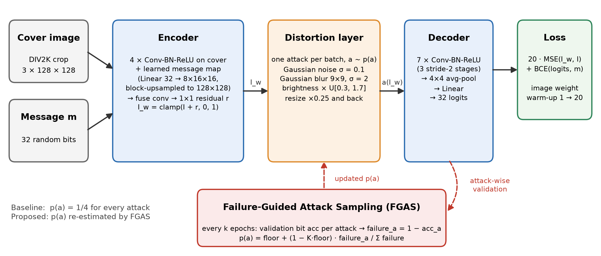 | 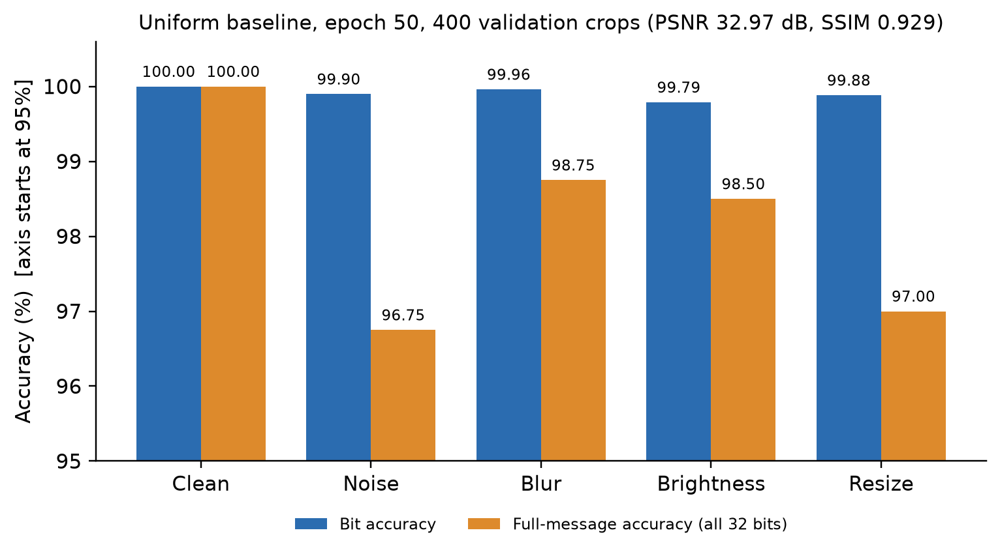 |
| 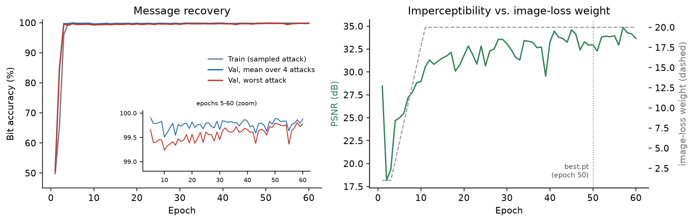 | 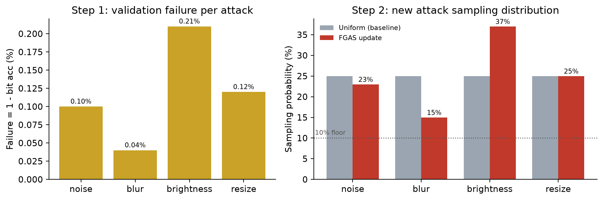 |

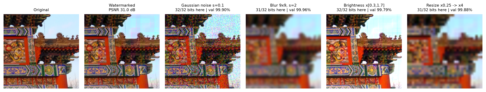
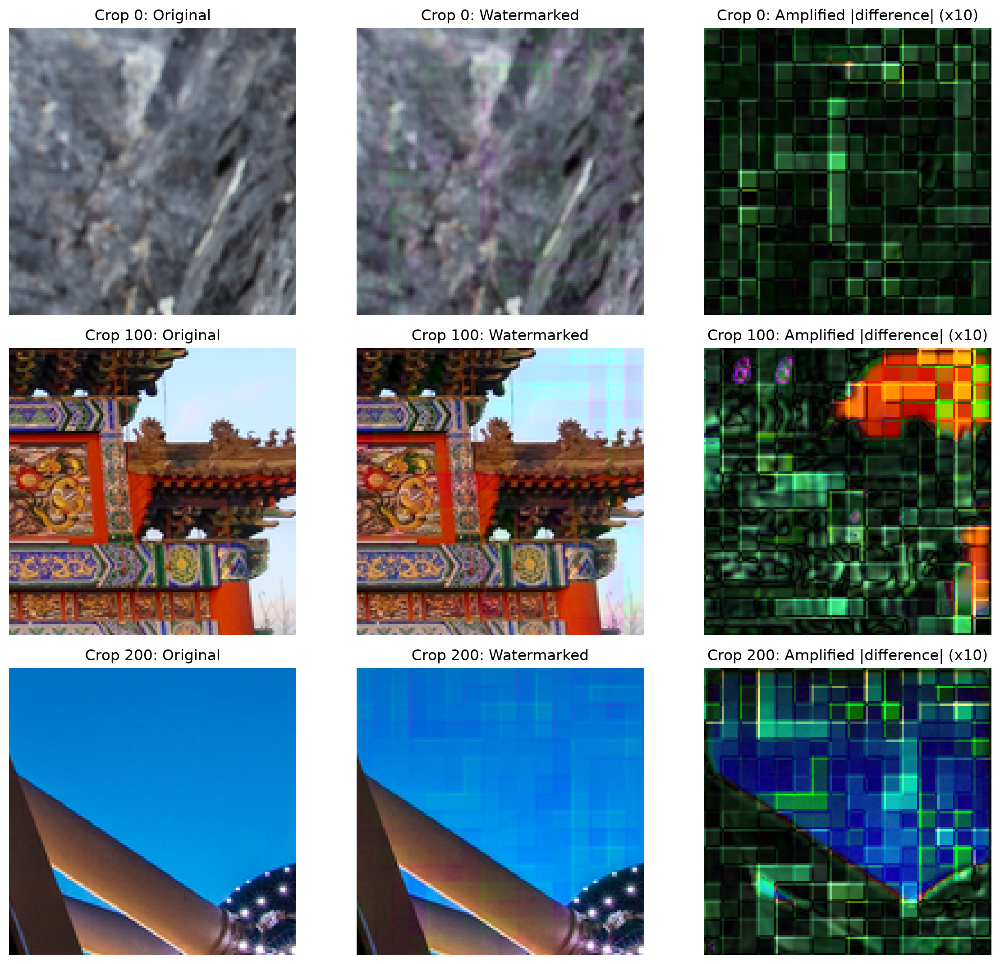

## Hardened benchmark: uniform vs FGAS (Colab T4)

The baseline above is saturated: every attack is at 99.8% or higher, so there are no failures for FGAS to adapt to. Experiment D confirms this. Continuing the baseline for 10 epochs with FGAS or with uniform sampling (3 seeds each, `results/checkin3/exp_d.md`) gives the same worst case (brightness, 99.65 ± 0.10% vs. 99.68 ± 0.13%) and the same mean attacked accuracy (99.85%).

We therefore made the task harder ([configs/hard_base.yaml](configs/hard_base.yaml)):

- **Data.** Training and model selection use COCO val2017 (4500 train / 500 validation images, short side 256, PNG). DIV2K valid HR is a **held-out test set** (100 images × 4 fixed crops) that is never used for training, checkpoint selection or FGAS.
- **Attacks.** Seven training attacks: noise σ=0.1, blur 9×9 σ=2, brightness ×U[0.3, 1.7], resize ×0.25, differentiable JPEG Q∈[50, 90], crop keeping 50-80% of the area (resized back), and occlusion of 10-25% of the area. Real JPEG Q50 and resize 0.5 + real JPEG are evaluated but never trained on.
- **Imperceptibility.** The final image-loss weight is 200, up from 20.
- **Warm-up.** Batches use only noise/blur/brightness/resize until the message is learned, then all seven attacks. Both methods get the same warm-up.
- **FGAS settings.** Update every 2 epochs, floor 0.05, power 1, momentum 0.5.
- **Comparison.** [configs/hard_uniform.yaml](configs/hard_uniform.yaml) and [configs/hard_fgas.yaml](configs/hard_fgas.yaml) differ only in the `fgas` block (checked by `tests/test_configs.py`).

Calibration findings from development runs:
- With 25-50% occlusion during training, bit accuracy stayed at chance and the message was never learned.
- With all seven attacks from the first batch, whether training ever left chance accuracy varied between otherwise identical runs. The attack warm-up fixed both problems.

**Results on the DIV2K test set** (seed 42, Tesla T4, `results/checkin3/`). The success test, set before the runs, was worst-case bit accuracy +2 pp or more, PSNR within 0.5 dB, mean attacked accuracy no more than 0.5 pp lower, and clean accuracy ≥ 98%.

| | Uniform | FGAS |
|---|---|---|
| PSNR / SSIM | 36.04 dB / 0.975 | 35.70 dB / 0.979 |
| Clean bit accuracy | 99.97% | 99.97% |
| **Worst attack (crop) bit accuracy** | **86.30%** | **93.66%** (+7.4 pp) |
| Crop full-message accuracy | 14.25% | 44.75% |
| Mean over the 7 training attacks | 97.49% | 98.29% |
| Noise σ=0.1 | 98.92% | 97.87% |
| Real JPEG Q50 / resize 0.5 + real JPEG | 99.45% / 99.34% | 99.17% / 99.02% |

On this seed FGAS passes the test (`main_comparison_criterion.json`). This was a single seed; the 5-seed results are under [Final results](#final-results).

FGAS moved its sampling toward crop: crop's probability was 29-38% after warm-up, against 1/7 ≈ 14% under uniform sampling. It took batches mainly from blur, resize and JPEG, which were already near 100%.

The severity sweep shows two things:
- The crop gain holds beyond the training strength. Keeping 50% of the area gives 80.8% vs. 70.0%, and keeping 35% gives 62.9% vs. 55.9%.
- There is a cost on strong noise: 82.9% vs. 87.5% at σ=0.2, which is beyond the training strength.

Neither method reached the 38 dB PSNR target (about 36 dB at weight 200).

| | |
|---|---|
| 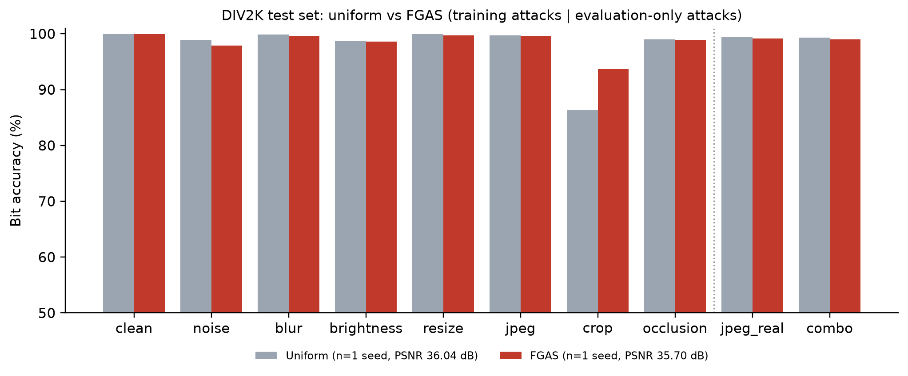 | 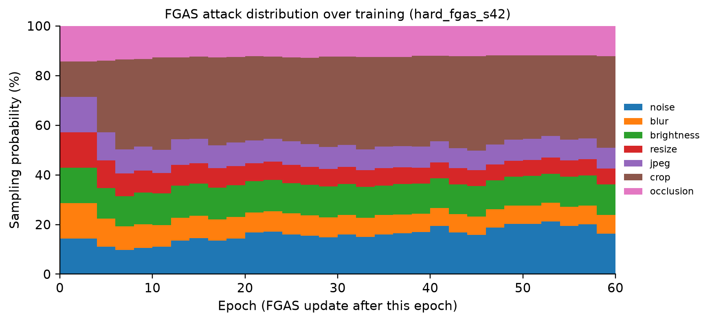 |

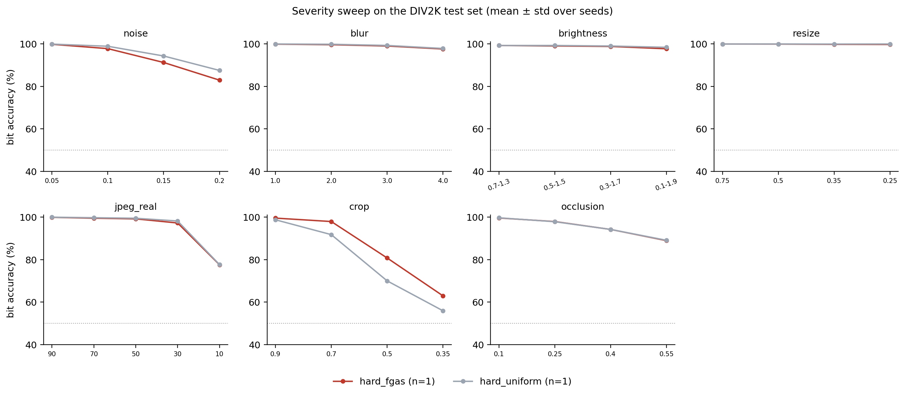
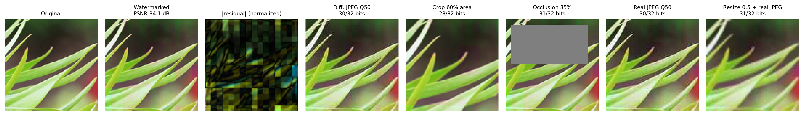

The canonical run for this section is [notebooks/checkin3_colab.ipynb](notebooks/checkin3_colab.ipynb). Set `MY_JOBS` (e.g. `['hard_uniform_s42', 'hard_fgas_s42']`) and run all. Runs are written to Drive and resume after a disconnect.

## Final results

**In short** (DIV2K test set, 5 seeds per method, Colab Tesla T4):
- **FGAS makes the watermark much harder to break with the hardest attack (crop):** worst-case bit accuracy 94.05% vs 86.52% for uniform sampling, **+7.5 pp, better on 5 of 5 seeds**. Full messages survive cropping about 3× more often (47.6% vs 15.0%).
- It is also ahead on the average over all attacks (+1.1 pp) and on full-message accuracy (+4.4 pp), on every seed.
- The price is image quality: 35.4 vs 36.2 dB PSNR (both imperceptible), 0.3 dB over the limit we set before the runs.
- A **fixed** attack mix equal to the one FGAS learns does as well as FGAS. The gain comes from training much more on the hardest attack; FGAS finds that mix automatically from validation failures.
- The gain holds at every image-quality level we tried and for every FGAS setting (single-seed ablations).

### Main result: uniform vs static mix vs FGAS (5 seeds)

Five seeds (42–46) per method, 60 epochs, image-loss weight 200, scored on the held-out DIV2K test set. All runs use the fixed warm-up described below; an earlier attempt without it is covered under [Training reliability](#training-reliability-the-first-attempt-and-the-warm-up-fix). Results are in [results/final/warm0/](results/final/warm0/).

**The change:**
- The image-loss weight is **0** during the attack warm-up (`train.image_loss_weight_start: 0.0`), instead of 1. Nothing pushes the residual towards zero before the message is learned, so the collapse seen in the first attempt ([#12](https://github.com/TaehunLeee5/CMPE258_Team7/issues/12)) cannot start.
- Everything else is unchanged: after the warm-up, the weight ramps to 200 as before.
- Configs: [hard_uniform_warm0.yaml](configs/hard_uniform_warm0.yaml) and [hard_fgas_warm0.yaml](configs/hard_fgas_warm0.yaml). Each differs from its parent only in that key, and they differ from each other only in `fgas` (checked by `tests/test_configs.py`).

**Static-mix baseline** ([hard_static_warm0.yaml](configs/hard_static_warm0.yaml), [#19](https://github.com/TaehunLeee5/CMPE258_Team7/issues/19)):
- Same as `hard_uniform_warm0`, but after the warm-up it samples a **fixed** non-uniform attack mix: noise 0.157, blur 0.082, brightness 0.128, resize 0.073, jpeg 0.090, **crop 0.345**, occlusion 0.125.
- This is the mean FGAS distribution of `hard_fgas_s42` and `hard_fgas_s46`, fixed before any run.
- It tests whether FGAS needs to *adapt* during training, or only to arrive at the right mix.

**Protocol:**
- Fixed before launch: seeds 42–46 for all three methods, and the success test below (uniform vs FGAS, the same thresholds as the first attempt). FGAS vs static is descriptive only.
- A development check on the seeds that had collapsed (43–45, 12 epochs) passed before the official runs ([#13](https://github.com/TaehunLeee5/CMPE258_Team7/issues/13)).
- All 15 runs trained for 60 epochs on a Colab Tesla T4:
  - seeds 42–44 from commit `c62de5d`;
  - seeds 45–46 from commit `dede946`.

  The two commits differ only by the optional U-Net encoder. The default model builds identical weights from the same seed in both.
- Severity sweeps also ran on a Colab T4.

**All 15 runs learned the message:** clean bit accuracy ≥ 99.6% and PSNR 34.7–36.7 dB. No run stayed at chance.

| | Uniform | Static mix | FGAS |
|---|---|---|---|
| **Worst attack (crop) bit accuracy** | 86.52 ± 2.38% | **94.07 ± 1.20%** | **94.05 ± 0.52%** |
| Crop full-message accuracy | 14.95 ± 7.32% | 50.45 ± 5.65% | 47.55 ± 1.97% |
| Mean attacked bit accuracy (7 training attacks) | 97.28 ± 0.38% | 98.29 ± 0.36% | 98.36 ± 0.06% |
| Full-message accuracy (mean over the 7 attacks) | 73.93 ± 2.96% | 77.69 ± 3.16% | 78.31 ± 1.61% |
| Noise full-message accuracy | 63.20 ± 9.07% | 57.45 ± 9.14% | 59.95 ± 10.19% |
| PSNR | 36.17 ± 0.47 dB | 35.22 ± 0.30 dB | 35.37 ± 0.46 dB |
| Clean bit accuracy | 99.89% | 99.86% | 99.89% |

Mean ± sample std over 5 seeds, DIV2K test set ([main_comparison.md](results/final/warm0/main_comparison.md), [per_run.md](results/final/warm0/per_run.md)).

**Success test (set before the runs): robustness passed easily; image quality missed the limit by 0.3 dB** ([main_comparison_criterion.json](results/final/warm0/main_comparison_criterion.json)).

| Check | Required | Result | Pass |
|---|---|---|---|
| Worst-case bit accuracy | ≥ +2 pp | **+7.53 pp** | yes |
| PSNR | within 0.5 dB | **−0.80 dB** | **no** |
| Mean attacked bit accuracy | not more than 0.5 pp lower | +1.08 pp | yes |
| Clean bit accuracy | ≥ 98% | 99.89% | yes |

**Paired per-seed differences, FGAS − uniform:**

| Seed | 42 | 43 | 44 | 45 | 46 | Mean ± std |
|---|---|---|---|---|---|---|
| Worst case (pp) | +9.52 | +7.16 | +7.41 | +4.52 | +9.05 | **+7.53 ± 1.97** |
| Mean attacked (pp) | +1.24 | +1.27 | +0.99 | +0.54 | +1.37 | +1.08 ± 0.33 |
| Full-message (pp) | +3.07 | +8.61 | +3.32 | +0.14 | +6.79 | +4.39 ± 3.33 |
| PSNR (dB) | −0.51 | −1.40 | +0.37 | −1.41 | −1.08 | −0.80 ± 0.75 |

FGAS has the better worst case on **5 of 5** seeds, and a higher mean attacked and full-message accuracy on every seed. It costs 0.80 dB of PSNR on average. Both methods stay around 35–36 dB, but 0.80 dB is over the 0.5 dB limit we set in advance, so we count the test as not passed.

For scale (post hoc, from the single-seed trade-off runs below, original warm-up): uniform sampling gains about 1.8 pp of worst-case accuracy per dB of PSNR it gives up (weight 200 → 100: +4.05 pp for −2.27 dB). Bought that way, 0.8 dB would be worth roughly 1.4 pp, against FGAS's +7.5 pp. This is a rough comparison, not a test.

**FGAS vs the static mix** ([static_vs_fgas_criterion.json](results/final/warm0/static_vs_fgas_criterion.json); descriptive, as decided before the runs):
- Paired FGAS − static: worst case −0.01 ± 1.03 pp (FGAS better on 1 of 5 seeds), mean attacked +0.07 ± 0.32 pp, full-message +0.62 ± 3.34 pp, PSNR +0.15 ± 0.50 dB.
- The two are **indistinguishable**. The gain over uniform comes from the final attack mix (much more crop), not from adapting it during training.
- The PSNR cost also comes from the mix: the static mix is 0.95 dB below uniform.
- What FGAS contributes is **finding** that mix automatically, from validation failures, without knowing in advance which attack is hardest. The static mix used here was only available because FGAS had found it.

**Severity sweep** ([severity_sweep.png](results/final/warm0/figures/severity_sweep.png), mean ± std over 5 seeds):

| Attack | Uniform | Static mix | FGAS |
|---|---|---|---|
| Crop, keep 50% | 71.5% | 81.9% | 81.3% |
| Crop, keep 35% | 57.1% | 63.4% | 62.7% |
| Noise σ = 0.2 | 87.0% | 84.2% | 85.5% |
| Occlusion 55% | 87.8% | 88.8% | 88.7% |
| Real JPEG Q10 | 73.1% | 72.9% | 71.0% |

The crop gain holds beyond the training strength. The crop-heavy mixes (static and FGAS) are 1.5–2.8 pp behind on strong noise.

| | |
|---|---|
| 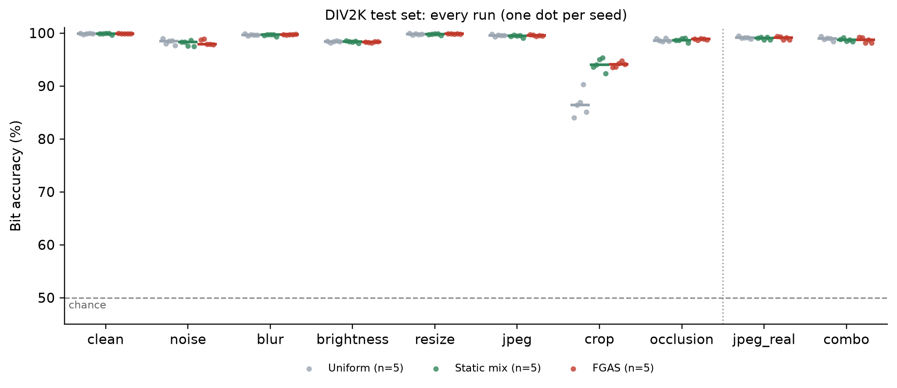 |  |
| 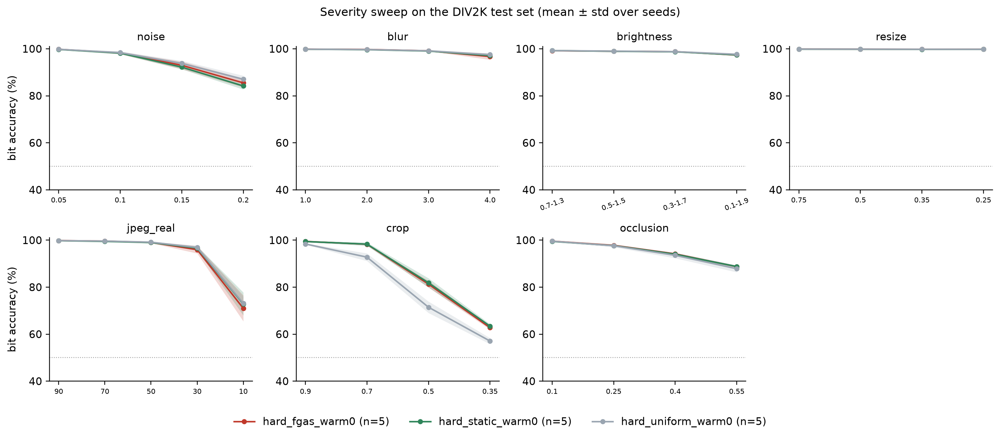 | 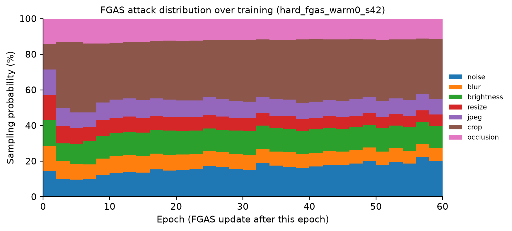 |

**Sampling vs loss weighting** ([#15](https://github.com/TaehunLeee5/CMPE258_Team7/issues/15); seed 42 only, exploratory; [sampling_vs_lossweight.md](results/final/warm0/sampling_vs_lossweight.md)).

`hard_fgas_lossweight_warm0` keeps uniform sampling and instead multiplies each attack's message loss by K · p_a, as Group DRO re-weights the training loss. At the end of training, crop's loss weight was 2.53 and resize's 0.49.

| Seed 42, fixed warm-up | Worst case (crop) | Mean attacked | Full-message | PSNR |
|---|---|---|---|---|
| Uniform | 84.00% | 97.15% | 76.61% | 35.87 dB |
| FGAS, loss weighting | 91.20% | 97.67% | 74.07% | 35.39 dB |
| FGAS, sampling (default) | 93.52% | 98.39% | 79.68% | 35.36 dB |

On this seed:
- both ways of using the FGAS signal improve the worst case over uniform;
- re-weighting **sampling** does better than re-weighting the **loss**, at the same PSNR.

With n = 1 this is a direction, not a result.

Reproduce: in [notebooks/checkin3_colab.ipynb](notebooks/checkin3_colab.ipynb), add the jobs below, run them, then run the sweep cell. Then build the tables and figures locally:

```python
for seed in (42, 43, 44, 45, 46):
    ALL_JOBS[f'hard_uniform_warm0_s{seed}'] = ('configs/hard_uniform_warm0.yaml', seed, [])
    ALL_JOBS[f'hard_fgas_warm0_s{seed}'] = ('configs/hard_fgas_warm0.yaml', seed, [])
    ALL_JOBS[f'hard_static_warm0_s{seed}'] = ('configs/hard_static_warm0.yaml', seed, [])
ALL_JOBS['hard_fgas_lossweight_warm0_s42'] = ('configs/hard_fgas_lossweight_warm0.yaml', 42, [])
```

```bash
W=results/final/warm0; R=$W/runs
python scripts/aggregate_seeds.py $R/hard_uniform_warm0_s* $R/hard_static_warm0_s* $R/hard_fgas_warm0_s* \
    --out $W/main_comparison --criterion hard_uniform_warm0 hard_fgas_warm0
python scripts/aggregate_seeds.py $R/hard_static_warm0_s* $R/hard_fgas_warm0_s* --out $W/static_vs_fgas \
    --criterion hard_static_warm0 hard_fgas_warm0
python scripts/aggregate_seeds.py $R/hard_uniform_warm0_s* $R/hard_static_warm0_s* $R/hard_fgas_warm0_s* \
    --no-group --out $W/per_run
python scripts/aggregate_seeds.py $R/hard_uniform_warm0_s42 $R/hard_fgas_warm0_s42 $R/hard_fgas_lossweight_warm0_s42 \
    --no-group --out $W/sampling_vs_lossweight
python scripts/sweep.py --plot $R/hard_{uniform,static,fgas}_warm0_s*/sweep.csv --out $W/figures/severity_sweep.png
python scripts/report_figures.py --hard-dir $W --out-dir $W/figures --only method_bars per_run_strip fgas_over_time
```

### FGAS variants and image-quality trade-off

All runs are seed 42 on a Colab Tesla T4, use the hardened benchmark above (60 epochs, same warm-ups) and are scored on the DIV2K test set. Results are in [results/final/variants/](results/final/variants/). These runs are **single-seed and exploratory**; they are not part of the success test. "Full-message" is the mean over the 7 training attacks of the fraction of images with all 32 bits correct.

**Trade-off at matched image quality.** FGAS and uniform sampling were also trained at image-loss weights 100 and 400 (`--set train.image_loss_weight=...`); weight 200 is the main comparison.

| Image weight | Method | PSNR (dB) | Worst case (crop) | Mean attacked | Full-message |
|---|---|---|---|---|---|
| 100 | Uniform | 33.77 | 90.35% | 98.18% | 82.32% |
| 100 | FGAS | 33.33 | **94.76%** | 98.61% | 82.46% |
| 200 | Uniform | 36.04 | 86.30% | 97.49% | 78.25% |
| 200 | FGAS | 35.70 | **93.66%** | 98.29% | 77.29% |
| 400 | Uniform | 37.71 | 86.11% | 97.20% | 71.61% |
| 400 | FGAS | 37.92 | **91.60%** | 97.50% | 68.54% |

- FGAS's worst-case bit accuracy is 4.4 to 7.4 pp higher at every weight. At weight 400 FGAS also has the higher PSNR (+0.21 dB), so the gain is not explained by a weaker image-quality constraint.
- Mean attacked bit accuracy is higher for FGAS at every weight (+0.3 to +0.8 pp).
- Full-message accuracy is not: FGAS is +0.1 pp at weight 100 but −1.0 pp at 200 and −3.1 pp at 400. The cost is concentrated on noise: noise full-message accuracy is 33.25% vs. 48.00% at weight 400. This is not explained by fewer noise batches: at weights 200 and 400, FGAS sampled noise slightly *more* often than uniform (mean probability 0.16 and 0.18 vs. 0.14, from `fgas_history.json`). The cause is still open.
- Weight 400 raised PSNR to about 38 dB without collapse for either method.

**Ablations.** Each config changes one FGAS setting from [configs/hard_fgas.yaml](configs/hard_fgas.yaml) (checked by `tests/test_configs.py`).

| Variant | Config | PSNR (dB) | Worst case (crop) | Mean attacked | Full-message |
|---|---|---|---|---|---|
| Uniform (reference) | `hard_uniform` | 36.04 | 86.30% | 97.49% | 78.25% |
| FGAS default (floor 0.05, every 2 epochs, power 1) | `hard_fgas` | 35.70 | 93.66% | 98.29% | 77.29% |
| floor 0.02 | `hard_fgas_floor002` | 35.36 | 94.27% | 98.27% | 76.89% |
| floor 0.10 | `hard_fgas_floor010` | 35.43 | 92.21% | 98.16% | 77.75% |
| update every epoch | `hard_fgas_int1` | 35.30 | 94.80% | 98.50% | 79.29% |
| update every 5 epochs | `hard_fgas_int5` | 35.87 | 93.10% | 98.20% | 77.54% |
| power 2 | `hard_fgas_p2` | 35.26 | 94.52% | 98.31% | 78.25% |
| loss weighting (`fgas.mode: loss_weight`) | `hard_fgas_lossweight` | did not learn the message; rerun with the fixed warm-up, see the main result | | | |

- Every FGAS variant beats uniform on the worst case by 5.9 to 8.5 pp. The variants differ from each other by at most 2.6 pp on one seed, so they should not be ranked on these numbers.
- The higher floor (0.10, closer to uniform sampling) gives the smallest gain. Four of the five variants have 0.27 to 0.44 dB lower PSNR than default FGAS; updating every 5 epochs is 0.17 dB higher.
- The first loss-weighting run never learned the message: bit accuracy stayed at 50% from epoch 1, during the shared attack warm-up when every loss weight is still 1, so loss weighting never took effect. Same-seed runs differ on the GPU, and this was the only one of 12 that did not leave chance within the warm-up. It is kept as `runs/hard_fgas_lossweight_failed_s42`. The rerun used the fixed warm-up and is compared with uniform and FGAS under the same warm-up in "Sampling vs loss weighting" under the main result.

| | |
|---|---|
|  |  |

Reproduce: in [notebooks/checkin3_colab.ipynb](notebooks/checkin3_colab.ipynb), add the jobs below and list them in `MY_JOBS`, then build the tables and figures locally.

```python
for w in (100, 400):
    ALL_JOBS[f'hard_uniform_w{w}_s42'] = ('configs/hard_uniform.yaml', 42, [f'train.image_loss_weight={w}'])
    ALL_JOBS[f'hard_fgas_w{w}_s42'] = ('configs/hard_fgas.yaml', 42, [f'train.image_loss_weight={w}'])
for v in ('lossweight', 'floor002', 'floor010', 'int1', 'int5', 'p2'):
    ALL_JOBS[f'hard_fgas_{v}_s42'] = (f'configs/hard_fgas_{v}.yaml', 42, [])
```

```bash
V=results/final/variants; M=results/checkin3/runs
python scripts/aggregate_seeds.py $V/runs/hard_*_w*_s42 $M/hard_uniform_s42 $M/hard_fgas_s42 --no-group --out $V/trade_off
python scripts/aggregate_seeds.py $V/runs/hard_fgas_{floor,int,p2,lossweight}*_s42 $M/hard_uniform_s42 $M/hard_fgas_s42 \
    --no-group --out $V/ablations
python scripts/report_figures.py --hard-dir results/checkin3 --out-dir $V/figures --only trade_off ablations
```

### Training reliability: the first attempt and the warm-up fix

The first 5-seed attempt (`hard_uniform` / `hard_fgas`, seeds 42–46, results in [results/final/main/](results/final/main/)) used an image-loss weight of 1 during the attack warm-up instead of 0. **4 of its 10 runs never learned the message** (`hard_fgas_s43`–`s45` and `hard_uniform_s43`). They stayed at 50% (chance) on every attack, including clean images, with PSNR of 61–84 dB because the encoder learned to leave images unchanged.

Averaging those broken runs in pulls both methods down, and FGAS more (3 broken runs vs 1). So that attempt did not pass the same success test: worst case 67.1% vs 79.9% with the broken runs included ([main_comparison.md](results/final/main/main_comparison.md), [per_run.md](results/final/main/per_run.md)). On the two seeds where both methods learned the message, FGAS was ahead on crop by +7.4 and +4.9 pp, the same pattern as the main result.

**What went wrong** (evidence in [#12](https://github.com/TaehunLeee5/CMPE258_Team7/issues/12)):
- The outcome is decided in **epoch 2 of the shared warm-up, before FGAS does anything**. Uniform and FGAS run identical code until then.
- Runs that learn first make large, visible changes (PSNR about 17–21 dB), the decoder picks them up, and the image-loss ramp later makes the watermark invisible.
- Stuck runs shrink their changes first (PSNR about 34–41 dB). At about 0.01 per pixel, the signal is roughly 10× below the noise attack, so the decoder never sees it, and the image loss keeps pushing it towards zero.
- It is not specific to FGAS: uniform got stuck too, and even same-seed runs diverge on the GPU (`hard_uniform_s44` learned, `hard_fgas_s44` did not).

**The fix:** an image-loss weight of 0 until the message is learned. A check on exactly the seeds that had failed passed 6 of 6 ([#13](https://github.com/TaehunLeee5/CMPE258_Team7/issues/13)), and all 15 runs of the main result learned the message.

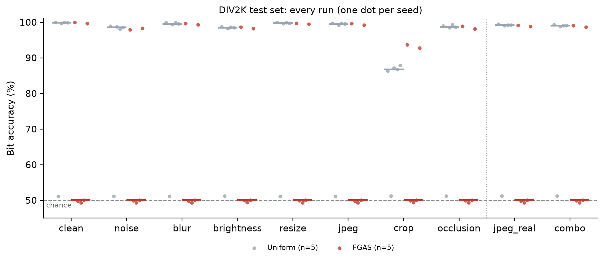

Every run of the first attempt, one dot per seed: the 4 stuck runs sit at 50% on every attack.

<details>
<summary>Where the first-attempt runs trained, and how to reproduce them</summary>

- Seed 42 is the run from the hardened benchmark section above (Colab Tesla T4, PyTorch 2.11.0); seeds 43–46 ran on a Colab Tesla T4 with PyTorch 2.14.1.
- `hard_fgas_s46` reached epoch 58 on Colab before the GPU quota ran out and resumed from `last.pt` on a Kaggle Tesla T4 (PyTorch 2.11.0) for epochs 59–60 and the test evaluation (`run_info_colab.json`, `run_info.json`). The severity sweeps for seeds 43–46 also ran on that Kaggle T4.
- Other figures: [mean ± std bars](results/final/main/figures/method_bars.png) (dominated by the stuck runs), [severity sweep, learned runs](results/final/main/figures/severity_sweep_learned_runs.png), [FGAS probabilities](results/final/main/figures/fgas_over_time.png), [Figure 1](results/final/main/figures/figure1.png).

Reproduce: in [notebooks/checkin3_colab.ipynb](notebooks/checkin3_colab.ipynb), add seeds 45 and 46 to `ALL_JOBS`, set `MY_JOBS` to `hard_{uniform,fgas}_s{43..46}`, and run (the sweep cell writes each run's `sweep.csv`). Then:

```bash
R=results/final/main/runs; F=results/final/main/figures
python scripts/aggregate_seeds.py $R/hard_uniform_s* $R/hard_fgas_s* --out results/final/main/main_comparison \
    --criterion hard_uniform hard_fgas
python scripts/aggregate_seeds.py $R/hard_uniform_s* $R/hard_fgas_s* --no-group --out results/final/main/per_run
python scripts/sweep.py --plot $R/hard_*_s*/sweep.csv --out $F/severity_sweep.png
python scripts/sweep.py --plot $R/hard_uniform_s4{2,4,5,6}/sweep.csv $R/hard_fgas_s4{2,6}/sweep.csv \
    --out $F/severity_sweep_learned_runs.png
python scripts/report_figures.py --hard-dir results/final/main --out-dir $F --only method_bars per_run_strip fgas_over_time
python scripts/figure1.py --checkpoint $R/hard_fgas_s42/best.pt --split test --indices 0 150 300 --out $F/figure1.png
```

</details>

## Repository layout

```
configs/      baseline.yaml, fgas.yaml, baseline_continue.yaml (DIV2K);
              hard_base.yaml, hard_uniform.yaml, hard_fgas.yaml, hard_fgas_p2.yaml, calib_*.yaml (hardened);
              hard_fgas_{floor002,floor010,int1,int5,lossweight}.yaml (FGAS ablations)
src/wm/       config, data, messages, models, attacks, metrics, evaluate, fgas, trainer
scripts/      download_div2k, prepare_div2k, validate_div2k, download_coco, prepare_coco, validate_coco,
              train, evaluate, sweep, fgas_update, figure1, report_figures, aggregate_seeds
notebooks/    checkin2_colab.ipynb (DIV2K baseline), checkin3_colab.ipynb (hardened benchmark runs)
tests/        pytest suite (shapes, gradients, attacks, metrics, FGAS, training loop)
results/      Colab T4 results (JSON/CSV), baseline checkpoint, figures/; checkin3/ (Experiment D, hardened runs);
              final/variants/ (image-weight trade-off and FGAS ablations)
```

## Team contributions

| Member | Contributions |
|---|---|
| Sabari Iyyappan Duraipandian | Repo structure, DIV2K pipeline, encoder/decoder, distortion layer, uniform sampling, attack-wise validation, FGAS scoring/update and training integration; FGAS variants (loss-weighting mode, ablation configs), trade-off and ablation figures; warm-up diagnosis and fix, static-mix baseline, fixed-warm-up results |
| Niveditha Nandakumar Kamath | Dataset and PSNR/SSIM validation, COCO pipeline and held-out test split, Figure 1, full-message and paired per-seed statistics, severity sweep, first 5-seed comparison, per-run strip plot, fixed-warm-up runs for seeds 45–46 |
| Taehun Lee | Baseline experiment runs, robustness benchmark, tables and plots, U-Net + squeeze-and-excitation encoder option, Gradio demo ([notebooks/demo_colab.ipynb](notebooks/demo_colab.ipynb)) |

Validation helpers: `python scripts/validate_div2k.py` checks the prepared DIV2K manifest and exports fixed validation-crop examples; `python scripts/figure1.py --checkpoint <best.pt>` draws Figure 1 (cover, watermarked, 10× amplified difference).

### Dataset and literature context

DIV2K is a high-resolution image dataset introduced for image restoration research. This project uses the first 600 of its 800 training images and the official 100-image validation split. Images are converted to RGB and resized with Lanczos interpolation while preserving aspect ratio until the shorter side is 512 pixels. Training uses random 128x128 crops with horizontal flips; validation uses four fixed, seed-controlled crops per image (400 crops total). The validation metrics therefore describe this fixed crop protocol, not full-resolution benchmark performance.

HiDDeN established an end-to-end learned image-watermarking approach in which an encoder embeds a message, differentiable distortions model common image transformations, and a decoder recovers the message. Watermark Anything with Localized Messages and Lightweight-Mark represent subsequent work on localized watermarking and efficient learned watermarking, respectively. This project adopts the encoder-distortion-decoder framing but studies a different question: whether redistributing training batches toward attacks with lower validation bit accuracy improves worst-case robustness relative to uniform attack sampling. The proposed Failure-Guided Attack Sampling (FGAS) rule uses attack-wise validation failures to adjust sampling probabilities while retaining a minimum probability for every attack; controlled comparisons should use the same model, data, and training budget.

The prepared DIV2K cache and `results/baseline_uniform/best.pt` are not included in a fresh clone. The validation command and Figure 1 generation therefore require the dataset preparation steps above and the baseline run to be completed first.

## References

- J. Zhu, R. Kaplan, J. Johnson, L. Fei-Fei. *HiDDeN: Hiding Data With Deep Networks.* ECCV 2018.
- T. Sander et al. *Watermark Anything with Localized Messages.* ICLR 2025.
- *Lightweight-Mark.* ICML 2025.
- E. Agustsson, R. Timofte. *NTIRE 2017 Challenge on Single Image Super-Resolution: Dataset and Study (DIV2K).* CVPRW 2017.
