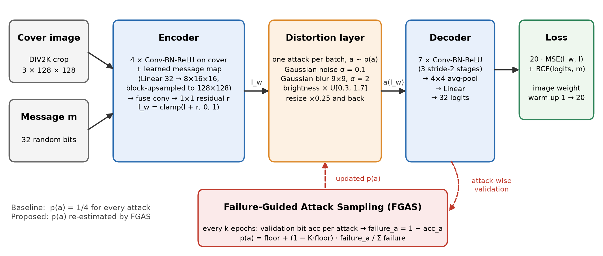
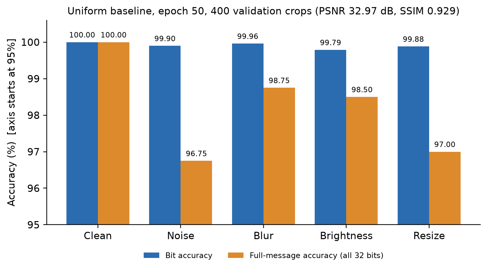
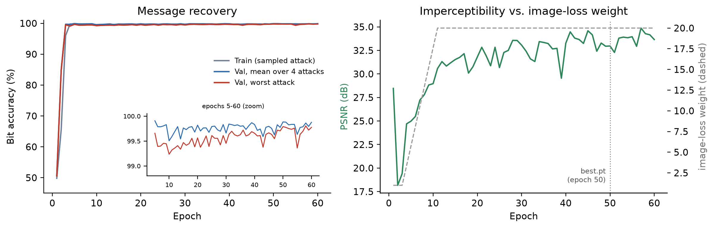
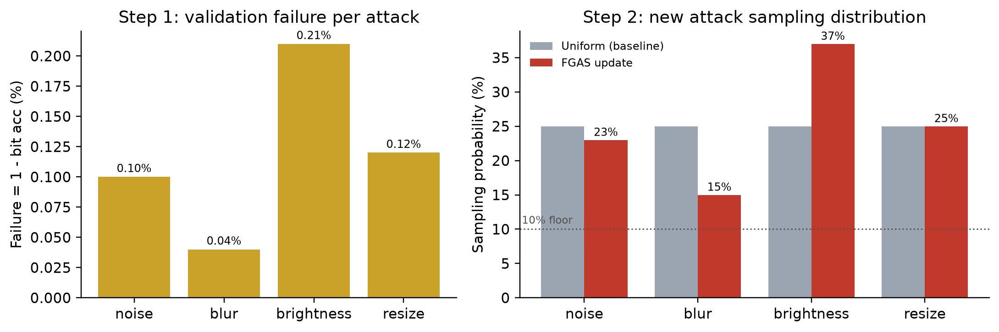
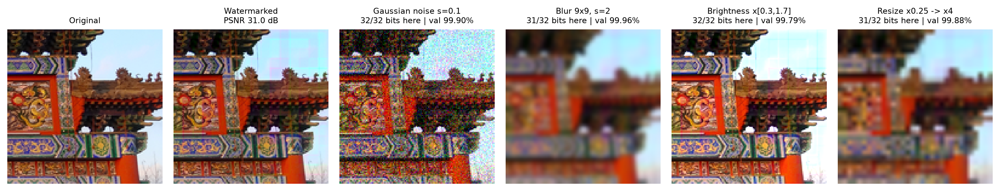
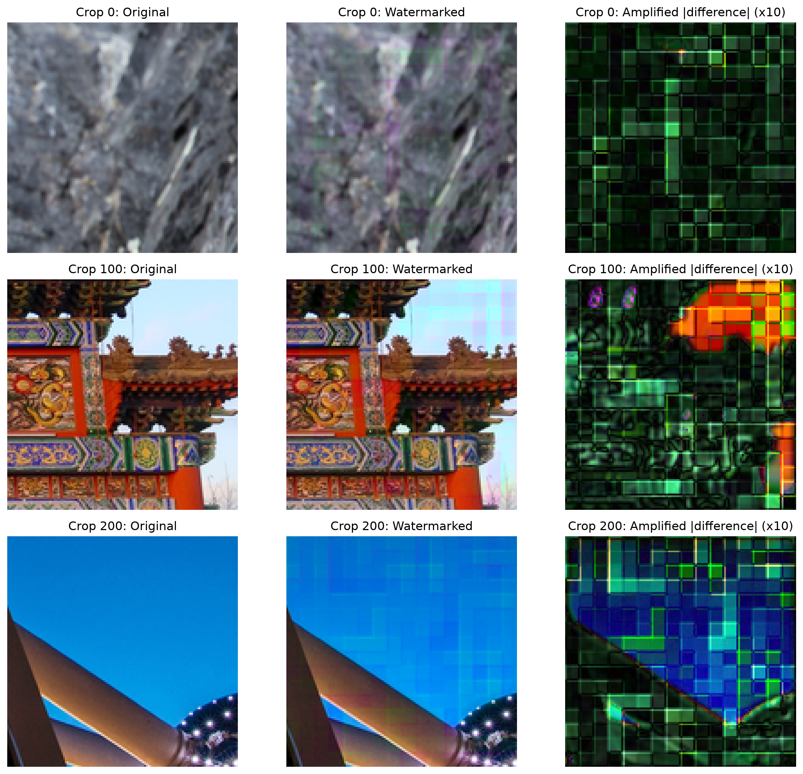

# Robust Neural Image Watermarking with Failure-Guided Attack Sampling

CMPE 258 · Team 7: Niveditha Nandakumar Kamath, Sabari Iyyappan Duraipandian, Taehun Lee

A HiDDeN-inspired neural watermarking prototype. An **encoder** hides a 32-bit message in an image, a **distortion layer** attacks the watermarked image, and a **decoder** recovers the bits. We compare two ways of choosing which distortion to train on:

1. **Uniform distortion sampling (baseline).** Every attack is drawn with equal probability.
2. **Failure-Guided Attack Sampling (FGAS, proposed).** The model is evaluated periodically under each attack separately, and attacks it recovers badly from are sampled more often.

Research question: *does dynamically allocating more training samples to the model's weakest distortions improve worst-case watermark recovery compared with uniform sampling?*

## Pipeline

```
cover (3x128x128) ─┐
                   ├─► Encoder ─► watermarked = clamp(cover + residual) ─► attack ~ p(attack) ─► Decoder ─► 32 logits
32-bit message ────┘                                                        noise | blur | brightness | resize
loss = w_img * MSE(watermarked, cover) + w_msg * BCE(logits, message)     (w_img warm-up, see below)
```

| Component | File | Notes |
|---|---|---|
| Config | [configs/baseline.yaml](configs/baseline.yaml) | Every hyperparameter is set here. `configs/fgas.yaml` inherits from it via `_base_`. |
| Data | [src/wm/data.py](src/wm/data.py) | DIV2K subset: 600 train HR + 100 valid HR, downscaled to a 512 short side. Training uses random 128×128 crops with flips. Validation uses fixed, seeded crops (4 per image, 400 total). |
| Messages | [src/wm/messages.py](src/wm/messages.py) | Random 32-bit {0,1} messages. |
| Model | [src/wm/models.py](src/wm/models.py) | The encoder predicts a residual from conv features of the cover, a learned 16×16 message map (upsampled) and the cover itself. The decoder is a conv stack (3 stride-2 stages), then 4×4 adaptive average pooling, then a linear layer. The original HiDDeN replicated-message / global-pool variant is still available (`message_embed: replicate`, `decoder_pool: 1`). |
| Attacks | [src/wm/attacks.py](src/wm/attacks.py) | Gaussian noise (σ=0.1), Gaussian blur (9×9, σ=2), brightness ×U[0.3,1.7], resize ×0.25 and back. All are differentiable and keep the input shape. `AttackSampler` draws one attack per batch. |
| Metrics | [src/wm/metrics.py](src/wm/metrics.py) | Bit accuracy, full-message accuracy, PSNR, SSIM. |
| Evaluation | [src/wm/evaluate.py](src/wm/evaluate.py) | Attack-wise evaluation. Each batch is watermarked once and decoded under every attack, plus a clean pass. Messages and attack randomness are seeded. |
| FGAS | [src/wm/fgas.py](src/wm/fgas.py) | Failure scores → new sampling distribution with a probability floor. |
| Training | [src/wm/trainer.py](src/wm/trainer.py) | Training loop with per-epoch attack-wise validation, logging, checkpointing and FGAS updates. |

### Training notes (from development runs)

These are short local runs on a GTX 1650, used only to choose the design. They are not reported results.

- **Message embedding.** With the original HiDDeN replicated message and a globally pooled decoder, bit accuracy was still about 0.58 after 8 epochs (32k crops). With the learned spatial message map and a 4×4-pooled decoder, it reached 0.97 after 2 epochs and 1.00 by epoch 5.
- **Image-loss warm-up.** With a large image weight from the start (w_img = 20, and also with a fixed epoch-based ramp), the encoder collapses to embedding nothing: PSNR above 50 dB, bit accuracy 0.5. So w_img stays at 1 until an epoch reaches 0.9 training bit accuracy (or epoch 10), then ramps linearly to 20 over 8 epochs. Only epochs at the final weight can become `best.pt`.
- **Attack strength.** With mild attacks (noise σ 0.03, blur σ 1, brightness 0.7–1.3, resize 0.5), a 16-epoch model reached 35 dB PSNR with ≥ 99.8% bit accuracy under *every* attack, so there is no failure signal for FGAS. Stress-testing that model at the current strengths separates the attacks (resize 0.93, noise 0.98, blur and brightness 0.99), and those strengths are the defaults now.

### FGAS update rule

For the K training attacks with validation bit accuracy `acc_a`:

```
failure_a = 1 - acc_a
p_a       = min_prob + (1 - K * min_prob) * failure_a^power / Σ_b failure_b^power
```

The default is `min_prob = 0.1` and `power = 1`. The result is a proper distribution: weaker attacks get more probability, and every attack keeps at least `min_prob`, so none disappears from training. Optional `momentum` blends in the previous distribution.

In training (`fgas.enabled: true`), the update runs every `fgas.update_interval` epochs. With `update_at_start: true` it also runs once on the starting weights. The new probabilities apply to the next batch onward. Every update is written to `fgas_history.json`.

## Reproducing the Check-In 2 results

**Canonical environment: Google Colab with a T4 GPU.** Team members use different machines, so all reported numbers come from [notebooks/checkin2_colab.ipynb](notebooks/checkin2_colab.ipynb) with seed 42. Open it in Colab, select `Runtime → Change runtime type → T4 GPU`, then `Run all`. The notebook runs the steps below and copies the outputs to the team Drive folder.

The same commands work on any machine:

```bash
pip install -r requirements.txt          # install a CUDA build of torch first if needed
python scripts/download_div2k.py         # DIV2K train + valid HR (~3.9 GB) -> data/DIV2K
python scripts/prepare_div2k.py          # 600 train / 100 val subset -> data/div2k_prepared
python -m pytest -q                      # unit tests (CPU, synthetic data, ~10 s)

# Experiments A + B: uniform baseline, then standalone attack-wise evaluation
python scripts/train.py --config configs/baseline.yaml
python scripts/evaluate.py --checkpoint runs/baseline_uniform/best.pt --out results/baseline_eval.json

# Experiment C: FGAS probability update from the baseline's validation results
python scripts/fgas_update.py --eval-json results/baseline_eval.json --out results/fgas_update.json

# Experiment D (optional): FGAS continuation vs. a matched uniform continuation
python scripts/train.py --config configs/fgas.yaml
python scripts/train.py --config configs/baseline_continue.yaml

# Hardened benchmark data: COCO val2017 (4500 train / 500 val, short side 256, PNG) for
# training; DIV2K valid HR (data.test) is the held-out test set
python scripts/download_coco.py --config configs/hard_base.yaml   # 5000 images -> data/COCO/val2017
python scripts/prepare_coco.py --config configs/hard_base.yaml    # -> data/coco_prepared
python scripts/validate_coco.py --config configs/hard_base.yaml   # manifest check + results/coco_samples/
python scripts/evaluate.py --checkpoint runs/hard_uniform_s42/best.pt --split test --out results/hard_test.json

# Severity sweep on the DIV2K test set (attacks.sweep) and its figure
python scripts/sweep.py --checkpoint runs/hard_uniform_s42/best.pt --out runs/hard_uniform_s42/sweep.csv
python scripts/sweep.py --plot runs/hard_*_s*/sweep.csv --out results/checkin3/figures/severity_sweep.png
```

Any config value can be overridden with `--set`, for example `--set train.epochs=5 data.synthetic=true experiment.name=debug`. Setting `data.synthetic=true` uses random smooth images, which makes for a quick smoke test without downloading anything.

### Outputs

Each training run writes to `runs/<experiment.name>/`:

| File | Contents |
|---|---|
| `config.yaml` | Resolved config |
| `run_info.json` | Git SHA, torch/CUDA, GPU, seed |
| `metrics.csv` / `metrics.jsonl` | One row per epoch: train loss and accuracy, validation bit/message accuracy per attack, PSNR, SSIM, worst-case attack, the sampling probability used, and how many batches each attack got |
| `best.pt` | Weights from the epoch with the best mean attacked bit accuracy |
| `last.pt` | Full state, for `--set train.resume=...` |
| `best_eval.json` | Attack-wise validation results for `best.pt` |
| `fgas_history.json` | All FGAS updates (FGAS runs only) |

`scripts/evaluate.py` writes `<out>.json` and `<out>.csv`, the per-attack table. `scripts/fgas_update.py` writes `<out>.json` and `<out>.csv`, containing attack, validation bit accuracy, failure, old probability and new probability. Committed evidence lives in [results/](results/).

## Results (Check-In 2, Colab T4)

Uniform baseline, `configs/baseline.yaml`: 60 epochs on a Tesla T4 (torch 2.11, seed 42). `best.pt` is from epoch 50 and was evaluated on 400 fixed validation crops (`results/baseline_eval.json`). Watermarked vs. cover: **PSNR 32.97 dB, SSIM 0.929**.

| Condition | Bit accuracy | Full-message accuracy (all 32 bits) |
|---|---|---|
| Clean | 100.00% | 100.00% |
| Gaussian noise σ=0.1 | 99.90% | 96.75% |
| Gaussian blur 9×9, σ=2 | 99.96% | 98.75% |
| Brightness ×U[0.3, 1.7] | **99.79%** (worst) | 98.50% |
| Resize ×0.25 and back | 99.88% | 97.00% |

FGAS update computed from these validation results (`results/fgas_update.csv`, floor 0.1):

| Attack | Failure (1 − bit acc) | Uniform p | FGAS p |
|---|---|---|---|
| Noise | 0.10% | 0.25 | 0.23 |
| Blur | 0.04% | 0.25 | 0.15 |
| Brightness | 0.21% | 0.25 | **0.37** |
| Resize | 0.12% | 0.25 | 0.25 |

A 2-epoch FGAS integration run (`results/fgas_integration_check/`) confirms the trainer uses these probabilities: brightness got 36 and 51 of 128 batches, against about 32 expected under uniform sampling. That run is only an integration check. The matched FGAS-vs-uniform comparison (Experiment D) is planned for the next check-in.

Figures (`python scripts/report_figures.py`, plus `scripts/figure1.py` for Figure 1):

| | |
|---|---|
|  |  |
|  |  |




## Repository layout

```
configs/      baseline.yaml, fgas.yaml, baseline_continue.yaml
src/wm/       config, data, messages, models, attacks, metrics, evaluate, fgas, trainer
scripts/      download_div2k, prepare_div2k, validate_div2k, download_coco, prepare_coco, validate_coco,
              train, evaluate, sweep, fgas_update, figure1, report_figures, aggregate_seeds
notebooks/    checkin2_colab.ipynb (canonical reproducible run)
tests/        pytest suite (shapes, gradients, attacks, metrics, FGAS, training loop)
results/      Colab T4 results (JSON/CSV), baseline checkpoint, figures/
```

## Team ownership and next steps

| Member | Ownership | Status |
|---|---|---|
| Sabari Iyyappan Duraipandian | Repo structure, DIV2K pipeline, encoder/decoder, distortion layer, uniform sampling, attack-wise validation, FGAS scoring/update, training integration | Done |
| Niveditha Nandakumar Kamath | Dataset validation, PSNR/SSIM validation, qualitative figures | TODO below |
| Taehun Lee | Baseline experiment runs, robustness benchmark, tables and plots | Done |

**TEAM_TODO, Niveditha**
Run `python scripts/validate_div2k.py` after preprocessing to check the manifest, split contents, RGB mode, resized dimensions, and to export deterministic validation-crop examples under `results/div2k_samples/`. The PSNR/SSIM unit test cross-checks the local metrics against `skimage.metrics`.

Generate Figure 1 after the baseline checkpoint is available with `python scripts/figure1.py --checkpoint results/baseline_uniform/best.pt`. The script uses fixed validation crops and seeded messages; its third column is the amplified absolute pixel difference (10x), not the unscaled residual.

### Dataset and literature context

DIV2K is a high-resolution image dataset introduced for image restoration research. This project uses the first 600 of its 800 training images and the official 100-image validation split. Images are converted to RGB and resized with Lanczos interpolation while preserving aspect ratio until the shorter side is 512 pixels. Training uses random 128x128 crops with horizontal flips; validation uses four fixed, seed-controlled crops per image (400 crops total). The validation metrics therefore describe this fixed crop protocol, not full-resolution benchmark performance.

HiDDeN established an end-to-end learned image-watermarking approach in which an encoder embeds a message, differentiable distortions model common image transformations, and a decoder recovers the message. Watermark Anything with Localized Messages and Lightweight-Mark represent subsequent work on localized watermarking and efficient learned watermarking, respectively. This project adopts the encoder-distortion-decoder framing but studies a different question: whether redistributing training batches toward attacks with lower validation bit accuracy improves worst-case robustness relative to uniform attack sampling. The proposed Failure-Guided Attack Sampling (FGAS) rule uses attack-wise validation failures to adjust sampling probabilities while retaining a minimum probability for every attack; controlled comparisons should use the same model, data, and training budget.

The prepared DIV2K cache and `results/baseline_uniform/best.pt` are not included in a fresh clone. The validation command and Figure 1 generation therefore require the dataset preparation steps above and the baseline run to be completed first; report numerical findings only after those runs.

**TEAM_TODO, Taehun[DONE]**
- Table 1 and Figure 2 from `results/baseline_eval.json` (clean, noise, blur, brightness, resize).
- Figure 3: training curves from `results/baseline_uniform/metrics.csv`.
- Table 2 from `results/fgas_update.csv`.
- Experiment D, run on Colab T4 (last cells of the notebook): `configs/fgas.yaml` vs. `configs/baseline_continue.yaml`, comparing per-attack and worst-case accuracy.
- Experimental-setup and preliminary-results text.

## References

- J. Zhu, R. Kaplan, J. Johnson, L. Fei-Fei. *HiDDeN: Hiding Data With Deep Networks.* ECCV 2018.
- T. Sander et al. *Watermark Anything with Localized Messages.* ICLR 2025.
- *Lightweight-Mark.* ICML 2025.
- E. Agustsson, R. Timofte. *NTIRE 2017 Challenge on Single Image Super-Resolution: Dataset and Study (DIV2K).* CVPRW 2017.
